# imagegen-director

[English](README.md) | 日本語

<p align="center">
<a href="media/L4-00508.png"></a>
<a href="media/L4-01860.png"></a>
<a href="media/L4-03798.png"></a>
<a href="media/L4-05916.png">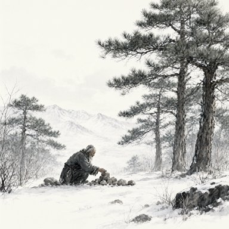</a><br>
<a href="media/L4-06514.png">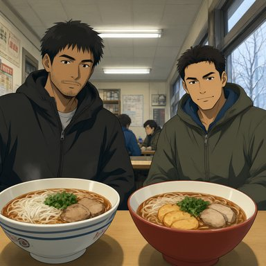</a>
<a href="media/L4-06820.png">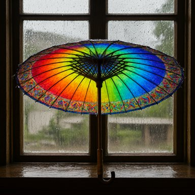</a>
<a href="media/L4-06943.png">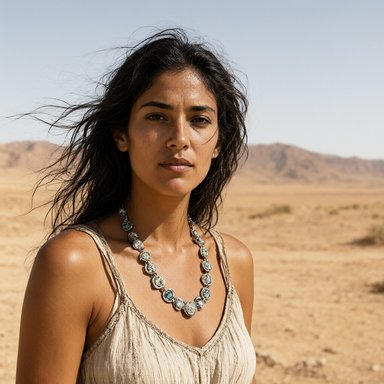</a>
<a href="media/L4-07208.png"></a><br>
<a href="media/L4-07570.png">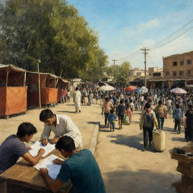</a>
<a href="media/L4-08561.png">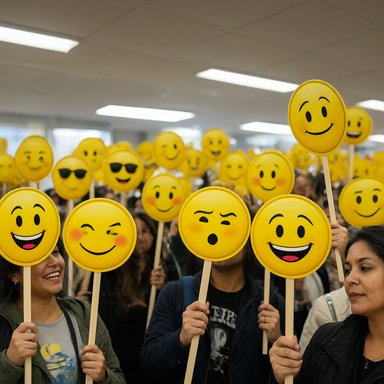</a>
<a href="media/L4-09248.png">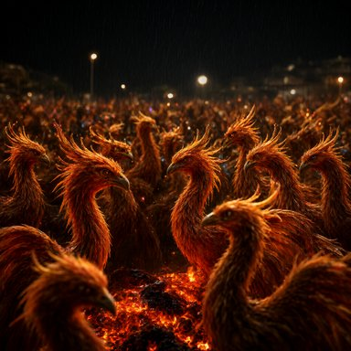</a>
<a href="media/L4-09392.png">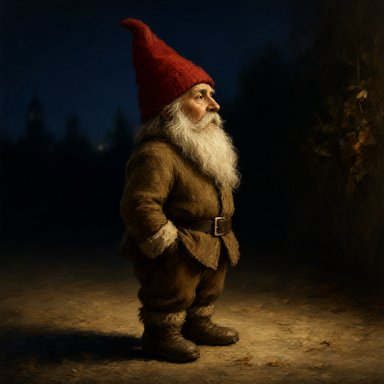</a><br>
<a href="media/L4-09619.png">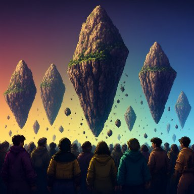</a>
<a href="media/L4-09757.png">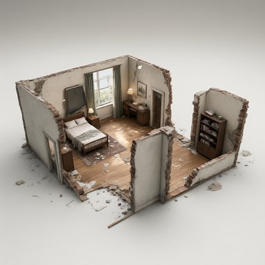</a>
<a href="media/L4-09787.png">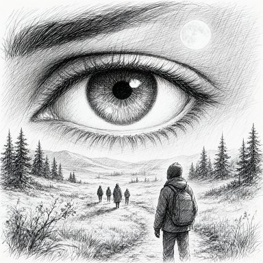</a>
<a href="media/L4-09979.png"></a>
</p>

<p align="center"><sub><a href="examples/datasets/the-world/">the-world</a> の例で生成した 10,000 枚から 16 枚
（Qwen-Image 2.1 Turbo、1024x1024）。クリックすると原寸で開きます。画像はこのリポジトリの
ライセンスの対象外です（<a href="media/NOTICE.md">media/NOTICE.md</a>）。</sub></p>

テーマに沿って、大量の画像生成用プロンプトをバランスよく多様に作るためのエージェントスキルです。
必要なら画像の生成まで進められます。

「アニメ風のキャラ画像を 100 枚」「ゲーム用のマップチップを 1000 枚」「幅広い題材の画像セット」の
ように頼むと、スキルがヒアリングしながら被写体の木と互いに独立した変化の軸を組み立て、
偏りなくサンプリングし、機械チェックのルールを通るモデル非依存のプロンプトを書き出します。

## 進め方

1. **目的と規模**：画像の用途、総枚数、1 つの被写体を何枚描くか。幅広い集合なら被写体あたり少なく、
   意図して深掘りするなら多く。
2. **被写体の木**（`taxonomy.yaml`）：何を描くか。ユーザーと 1 段ずつ広げます。葉が被写体です。
3. **軸**（`axes.yaml`）：画像をどう変化させるか。画材・構図・光・天気・表情・ポーズなどに
   重みを付け、全画像で共通にするものは定数にします。
4. **ルール**（`rules.yaml`）：プロンプトに対する機械チェックの制約です。よくある失敗を防ぐ
   共通ルール（撮影機材を画面に描き込ませない、生き物を密集させない、品質の呪文を使わない）の
   上に、テーマ固有のものを足します。
5. **サンプリング**：割り当て付きの重み付きサンプリングで、各被写体に組み合わせを配ります。
   均等に散らばり、軸どうしは独立で、seed が同じなら毎回同じ結果になります。
6. **プロンプト**：エージェントが 1 行につき 1 本、平易な英語のプロンプトを書きます。
   ルールを通らないものは採用されません。
7. **画像**（任意）：プロンプトと seed の JSONL を書き出し、好きな画像生成環境で数十枚を試し、
   見つかった問題はすべてルールにしてから残りを生成します。

各手順の結果は 1 つのプロジェクトフォルダ内のファイルとして残るので、途中で止めて再開でき、
プロンプトを作り直しても修正が失われません。

## リポジトリ構成

```
skills/imagegen-director/      スキル本体
  SKILL.md                     エージェントが従う手順
  guides/                      ファイル仕様、プロンプトの書き方、既知の落とし穴
  library/axes/                再利用できる軸（画材、アングル、光、表情、ポーズ、衣装 など）
  library/rules/universal.yaml すべてのプロンプトが通るべきルール
  scripts/                     サンプラー、assemble（ルールチェック）、書き出し、表示、整理
  presets/the-world/           1000 被写体 x 13 軸。examples/datasets/the-world の元になった設定
examples/
  datasets/the-world/          このプリセットで作った 10,000 件の公開プロンプト
  backends/                    特定のローカル環境向けの画像生成バッチ 2 種と、バックエンドの約束事
media/                         この README のサンプル画像
```

## インストール

`skills/imagegen-director/` をエージェントのスキル用ディレクトリにコピーします。Claude Code の例：

```bash
cp -r skills/imagegen-director ~/.claude/skills/
```

あとはエージェントに「検索テスト用に屋台料理の画像を 300 枚、バリエーション豊かに作りたい」の
ように頼むだけです。

動作要件：スクリプトには Python 3.10 以上と PyYAML が必要です。スキル自体は GPU を使いません。
画像生成の仕組みは同梱していません。
[examples/backends](examples/backends/) にある短い約束事を満たす画像生成環境なら何でも使えます。
そこにある 2 つの参考バッチを手直しして使うこともできます。

## クイックスタート（手動）

```bash
cp -r skills/imagegen-director/presets/the-world my-set     # スキルにプロジェクトを作らせても可
python skills/imagegen-director/scripts/sampler.py --project my-set
python skills/imagegen-director/scripts/show.py --project my-set --chunk 0
# my-set/l4_raw/chunk_000.txt ... にプロンプトを書いてから
python skills/imagegen-director/scripts/assemble.py --project my-set
```

## データセットの例

[examples/datasets/the-world](examples/datasets/the-world/)：抽象的な概念から空想の世界まで、
1000 被写体にわたる 10,000 件のプロンプトです。各行にサンプリングした軸の値がメタデータとして
付いています。`the-world` プリセットを被写体あたり 10 枚で使って作りました。幅広い集合が目的なら、
被写体あたりの枚数を減らして被写体を増やすほうが良い結果になるかもしれません。

## ライセンス

- コードとスキル（`skills/`、`examples/backends/`）：[MIT](LICENSE)
- プロンプトのデータセット（`examples/datasets/`）：[CC BY 4.0](LICENSE-DATA.md)
- サンプル画像（`media/`）：利用許諾は与えていません。Qwen-Image-2.1-Turbo（Qwen Research License、
  非商用）で生成した画像です。[media/NOTICE.md](media/NOTICE.md) を参照してください。
